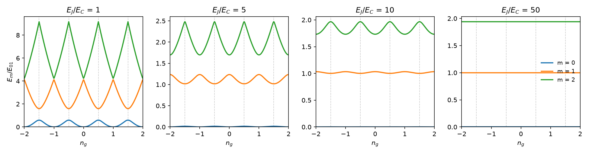
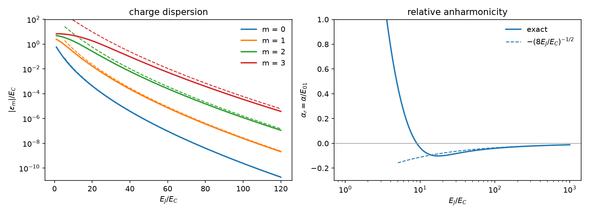
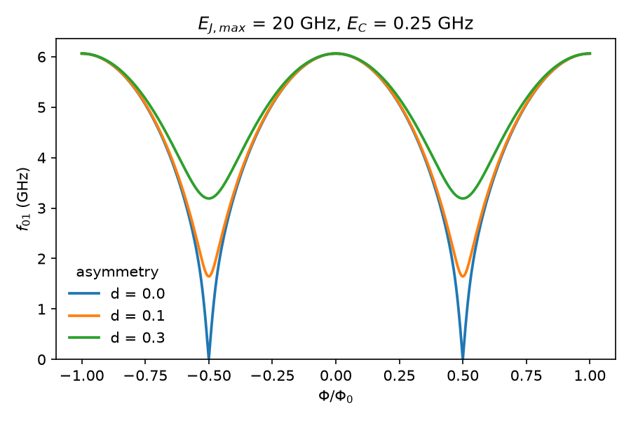
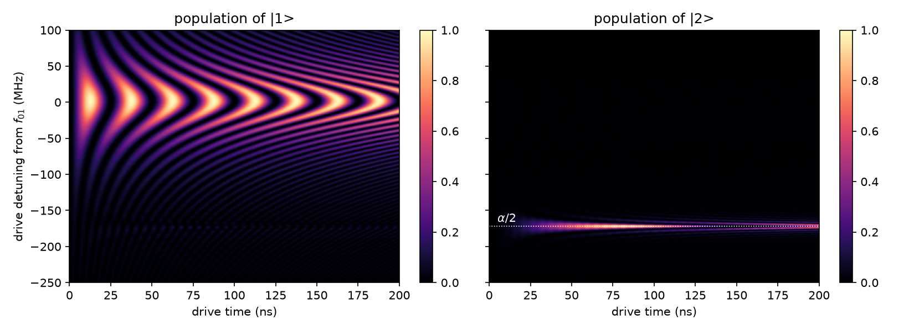
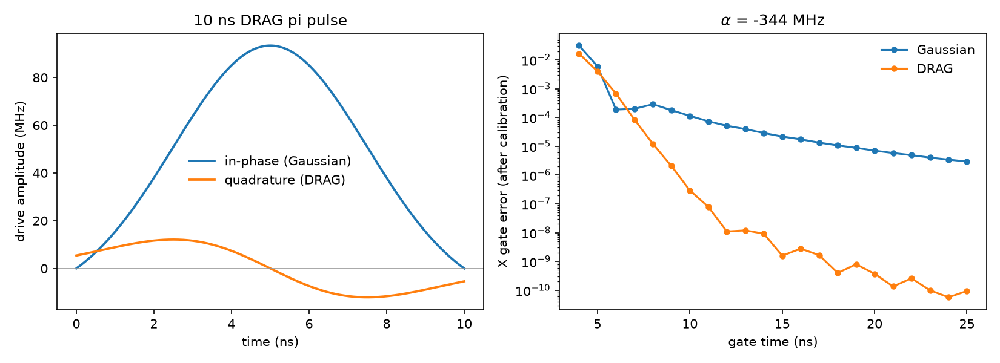

# transmon

A small Python simulator for a single transmon qubit. I wrote it while reading Koch et al., *Charge-insensitive qubit design derived from the Cooper pair box* (PRA 76, 042319, 2007), because I wanted to see the paper's results come out of the math myself instead of just reading them.

It builds the transmon Hamiltonian in the charge basis, diagonalizes it, and uses that to look at how the qubit frequency, anharmonicity and charge sensitivity change with EJ/EC and with flux. Then it drives the qubit with microwave pulses to see what the small anharmonicity actually costs when you try to do fast gates.

```
pip install -e .
python -m pytest
```

## The model

A transmon is a Josephson junction shunted by a big capacitor. Its Hamiltonian is (eq. 2.1)

```
H = 4 EC (n - ng)^2 - EJ cos(phi)
```

n is the number of Cooper pairs that have tunneled across the junction, phi is the phase across it, and ng is the offset charge from the gate and the environment. In the basis of charge states |n> the first term is diagonal and cos(phi) moves one Cooper pair across, so H is tridiagonal:

```
<n|H|n>   = 4 EC (n - ng)^2
<n±1|H|n> = -EJ / 2
```

I keep |n| ≤ 30, which is way more than needed (in the transmon regime the low states only spread over a few charge states), and hand it to `scipy.linalg.eigh_tridiagonal`.

To check it I compared against the exact solution in terms of Mathieu characteristic values (eq. 2.2). scipy only has those for integer order, which turns out to be exactly the cases ng = 0 and ng = 1/2, and the two methods agree to about 1e-13 for every EJ/EC I tried.

```python
from transmon import Transmon

q = Transmon(EJ=15, EC=0.3)    # GHz
q.f01                          # 5.683
q.anharmonicity                # -0.344
```

There's also a quick summary from the command line. `--Rn` is the junction's room-temperature resistance, converted to EJ with the Ambegaokar-Baratoff relation, since that's the number you actually measure when making a junction.

```
$ python -m transmon --Rn 10 --C 80
EJ = 14.043 GHz   EC = 0.2421 GHz   EJ/EC = 58.0
f01 = 4.9606 GHz   f12 = 4.6859 GHz
anharmonicity = -275 MHz   (alpha/EC = -1.134)
charge dispersion of f01 = 2.51 kHz peak to peak
<1|n|0> = 1.131   <2|n|1> = 1.554
```

## From Cooper pair box to transmon



This is Fig. 2 of the paper. At EJ/EC = 1 (a Cooper pair box) the levels swing hard with ng, so any stray charge on the chip moves the qubit frequency around. By EJ/EC = 50 the bands are basically flat.

## The tradeoff



This is the main point of the paper. The charge dispersion (left, compare Fig. 4a) falls off exponentially in sqrt(8 EJ/EC), eq. (2.5), while the relative anharmonicity (right, Fig. 5a) only falls like (EJ/EC)^(-1/2), eq. (2.12). Going from EJ/EC = 20 to 60 cuts the charge dispersion by more than 1000x and the anharmonicity by less than 2x. Dashed lines are the asymptotic formulas. The anharmonicity changes sign around EJ/EC ≈ 9 and has a shallow minimum near 17.5, same as the paper says.

The asymptotic formula for the dispersion also gives back the exact numbers quoted under eq. (2.8) (7.3e-2, 1.5e-4 and 8.9e-8 EC at EJ/EC = 20, 50, 100), which is one of the tests.

## Flux tuning



With two junctions in a SQUID loop, EJ depends on the flux through the loop, eq. (2.18), so the qubit frequency can be tuned with a magnetic field. For identical junctions EJ goes all the way to zero at half a flux quantum. Real junctions are never identical, and the asymmetry d decides how low the frequency gets. The bottom of those curves is a second sweet spot where the qubit is first-order insensitive to flux noise.

## Driving it



To actually use the qubit you drive it with microwaves near f01. I keep the lowest four levels, go into the frame rotating with the drive and make the rotating wave approximation, with the couplings between neighboring levels taken from the matrix elements <k+1|n|k> of the diagonalized transmon (they go like sqrt(k+1), eq. 3.4). On resonance the population flips back and forth between |0> and |1>, and detuning the drive gives the usual chevron. The line in the right panel at a detuning of α/2 is a two-photon 0 → 2 transition, which wouldn't be there at all if the transmon were a true two-level system.

## Leakage and DRAG



This is where the anharmonicity shows up. A short pulse has a wide spectrum, and once that width gets comparable to |α| the pulse starts driving 1 → 2 as well and population leaks out of the qubit. For each gate time I calibrate the pulse amplitude and drive frequency (the same knobs you tune on real hardware) and plot the X-gate error that's left. A plain Gaussian gets stuck around 1e-4 at 10 ns. Adding a DRAG correction, the time derivative of the pulse on the other quadrature scaled by 1/α (Motzoi et al. 2009), cancels the part of the spectrum sitting at the 1-2 transition and brings it to about 3e-7. Below ~6 ns neither one works well, the pulse is just too short compared to 1/|α|.

These are only coherent errors from the pulse itself, there's no T1 or T2 in the model, so the long-gate numbers are much smaller than anything a real device would get.

## Layout

```
transmon/
  transmon.py   Hamiltonian, energies, matrix elements, charge dispersion
  analytic.py   Mathieu solution and asymptotic formulas from the paper
  circuit.py    EJ and EC from circuit values, flux tuning
  dynamics.py   driven transmon in the rotating frame, pulses, gate error
examples/       one script per figure (python examples/tradeoff.py etc.)
tests/          checks against the paper
```

## Next

- Couple it to a readout resonator and compute the dispersive shift χ (Sec. III of the paper)
- Estimate T1 and T2 from the noise channels in Secs. IV and V
- Put in charge noise as a random ng(t) and watch the dephasing happen, instead of only computing the dispersion
- Two coupled transmons and a two-qubit gate

## References

- J. Koch et al., Charge-insensitive qubit design derived from the Cooper pair box, Phys. Rev. A 76, 042319 (2007), [arXiv:cond-mat/0703002](https://arxiv.org/abs/cond-mat/0703002)
- F. Motzoi, J. M. Gambetta, P. Rebentrost, F. K. Wilhelm, Simple pulses for elimination of leakage in weakly nonlinear qubits, Phys. Rev. Lett. 103, 110501 (2009)
- L. H. Pedersen, N. M. Møller, K. Mølmer, Fidelity of quantum operations, Phys. Lett. A 367, 47 (2007)
